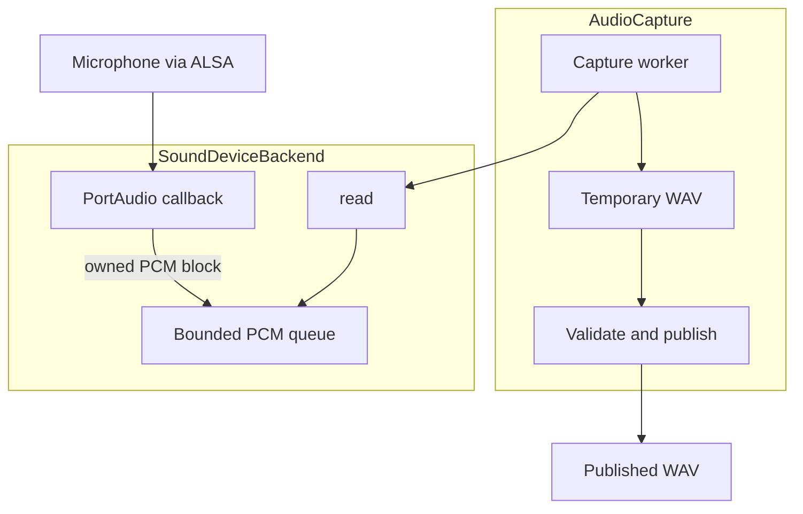
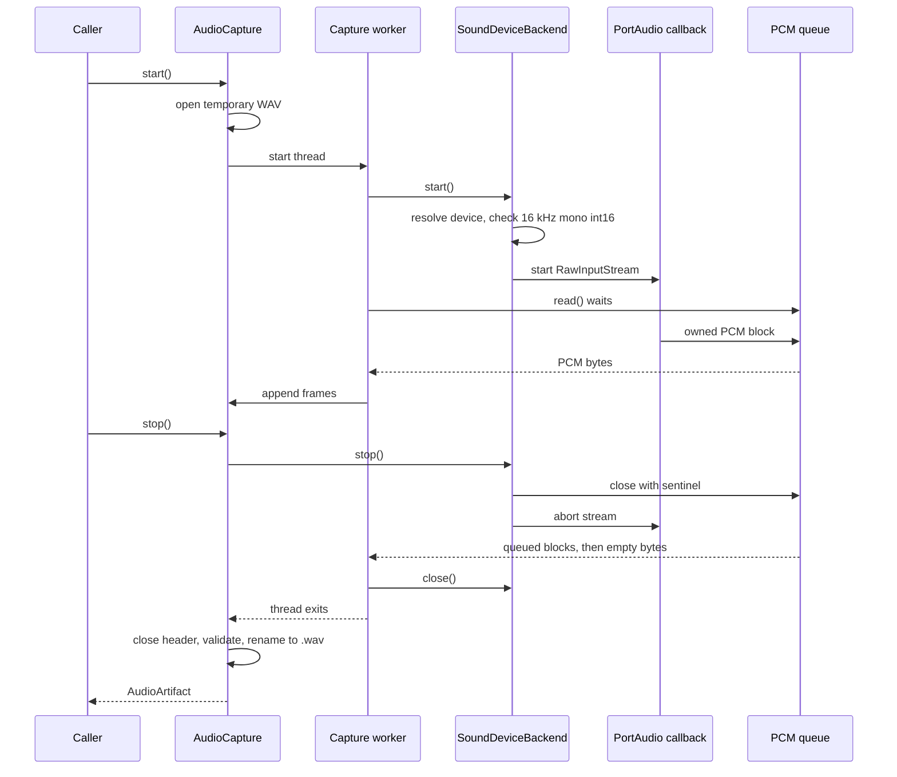

# Audio capture

How the Raspberry Pi records one push-to-talk utterance into a WAV file.
The button and the gesture live in the
[push-to-talk capture interface](../interfaces/push-to-talk-capture.md).
This page is the capture path itself: who owns the microphone, who owns the
file, and how a recording stops.

The decision to deliver PCM with a PortAudio callback and a bounded queue is
[ADR-0011](../decisions/0011-use-callback-driven-audio-capture-with-a-bounded-pcm-queue.md).
The earlier choice of `sounddevice` over `arecord` and PyAudio remains
[ADR-0003](../decisions/0003-use-event-driven-gpio-and-sounddevice-for-ptt-capture.md).

## Responsibilities

```text
Physical microphone
        |
        v
ALSA, including an optional plug device
        |
        v
PortAudio / sounddevice RawInputStream
        |
        v
Callback copies one PCM block
        |
        v
Bounded PCM queue
        |
        v
SoundDeviceBackend.read()
        |
        v
AudioCapture worker
        |
        v
Temporary WAV
        |
        v
Validated, published WAV
```

| Piece | Owns | Does not own |
| --- | --- | --- |
| ALSA | The hardware device and, on a `plug` PCM, format conversion before PortAudio sees the samples. | When to start or stop, the WAV file, device selection inside VoiceStock. |
| `SoundDeviceBackend` | Resolving `input_device`, opening the stream, the callback, the PCM queue, and unblocking `read`. | The WAV path, the button, resampling in Python. |
| `AudioCapture` | One recording at a time, the worker thread, the temporary file, validation, and publication. | Which microphone a deployment plugs in, speech-to-text. |
| `AudioInputBackend` | The four methods `start`, `read`, `stop`, and `close`. | PortAudio. Tests supply another implementation. |

`AudioCapture` is constructed with an `AudioCaptureConfig` and a backend.
Construction does not open a device. `SoundDeviceBackend` is created with the
configured device name. Importing `pi.audio` does not import `sounddevice`.



## Why the backend uses a callback

The first backend called `RawInputStream.read()` on the capture worker.
`stop` aborted the stream and joined that worker for five seconds. On the
Raspberry Pi, with the ALSA device `voicestock_mic`, abort returned and the
worker stayed blocked in `read`. A separate PortAudio check saw the same
thing for `abort()` and for `stop()`: both returned immediately, and the
reader was still alive after five seconds.

That behavior was observed on that board, that device, and that software
stack. It is not treated as a property of every microphone or every PortAudio
build. The production backend no longer depends on `abort()` to finish a
blocked `read`.

`read` now waits on a queue in the VoiceStock process. The PortAudio callback
is the producer. `stop` closes the queue, which wakes `read`, and then aborts
the stream so callbacks cease. Increasing the five-second join does not fix a
read that never returns, so the timeout was left unchanged.

## Producer and consumer

One PortAudio thread runs the callback. One capture thread runs
`AudioCapture._run`. The main or controller thread calls `start` and `stop`.

The callback may copy the incoming buffer into an owned `bytes` object and
`put` it on the queue. It does not write the WAV, open files, use the
network, or wait for free queue space. PortAudio only guarantees the buffer
for the duration of the callback, so the copy is required. That copy
allocates. Strict PortAudio guidance says not to allocate in the callback.
VoiceStock accepts the copy so the queue owns the samples, and does not add
any further work there.

`read` is the consumer. It returns one queued block, or empty bytes after a
normal stop. `AudioCapture` writes returned blocks to the temporary WAV.
Empty bytes end the worker loop, so audio that was queued before `stop` is
still written.

## Queue

The queue is a `queue.Queue` protected by the backend's own lock for depth
and shutdown. Capacity is `PCM_QUEUE_CAPACITY` in `pi.audio.config`, currently
32 data blocks.

| Quantity | Value |
| --- | --- |
| Block size | `FRAMES_PER_READ` = 1024 frames |
| Frame | 1 channel, signed 16-bit, 2 bytes |
| Block duration | 1024 / 16000 = 64 ms |
| Data capacity | 32 blocks, about 2.0 s, 64 KiB |
| Extra slot | 1, reserved for the shutdown sentinel |

The extra slot is not a place to store another audio block. Producers stop at
32 data blocks. `stop` and failures put one sentinel in the reserved slot, so
a waiting `read` wakes even when every data slot is full. The sentinel is not
audio. `read` returns the data blocks first. On the sentinel it raises a
stored failure, or returns `b""` when the close was a normal stop.

If a callback arrives while 32 data blocks are already queued and the capture
has not been stopped, the backend records `AudioStreamError` (`PCM input
queue overflowed`) and wakes the consumer. The new block is not stored, and
earlier blocks are not deleted inside the queue. The consumer can still read
those earlier blocks; the following `read` raises. `AudioCapture` then
discards the temporary file. A truncated take is not published as success.

A callback that arrives after `stop` has closed the queue is ignored. That
includes a PortAudio status flag. Dropping that late block is the end of the
take, not a silent hole in the middle of a recording that is then published.

32 blocks are sized for a Raspberry Pi 3 whose WAV writer is normally much
faster than 64 ms per block, while keeping a hard memory ceiling. It is not
an unbounded jitter buffer. A consumer that falls more than about two seconds
behind fails the recording.

## Format contract

`pi.audio.config` fixes the contract. These are not per-device options.

| Field | Value |
| --- | --- |
| Sample rate | 16000 Hz |
| Channels | 1 |
| Sample type | `int16` |
| WAV | PCM, `wave` module, 16-bit mono, 16000 Hz |
| Stream block | 1024 frames |

`start` calls `check_input_settings` before opening. A device that rejects
the contract raises `AudioDeviceUnsupportedError` and no stream is started.
The backend does not resample and does not downmix. ALSA may already have
converted the rate if the selected PortAudio device is a `plug` PCM. That
conversion is outside this process. See
[the G435 profile](../setup/alsa-microphone.md), which applies only to that
headset.

The opened device is whatever `input_device` matches. `voicestock_mic` and
the G435 name are not constants in the backend.

## Callback context

`sounddevice` invokes the callback from its PortAudio thread. The callback:

- returns immediately when this stream generation has been closed or `stop`
  has been requested;
- turns a truthy PortAudio status into `AudioStreamError` on the queue;
- copies the buffer and queues it;
- stores any exception from that copy as `AudioStreamError` (`audio callback
  failed`) instead of letting it disappear in the audio thread.

`finished_callback` covers a stream that stops on its own. If `stop` was not
requested, `read` fails with `input stream stopped unexpectedly`. If `stop`
was already requested, the finished callback only repeats the normal close.

## Errors

Existing types are unchanged.

| Situation | Result |
| --- | --- |
| Empty selector, or no name match | `AudioDeviceNotFoundError` |
| Several matches and the query is not one exact name | `AudioDeviceAmbiguousError` |
| Device rejects 16000 Hz mono `int16` | `AudioDeviceUnsupportedError` |
| PortAudio fails while listing or opening | `AudioStreamError` |
| Callback raises, or the buffer cannot be copied | `AudioStreamError` from `read` |
| Truthy PortAudio status while recording | `AudioStreamError` from `read` |
| Queue already holds 32 data blocks | `AudioStreamError` from the next `read` after the queued audio |
| Stream stops without `stop` | `AudioStreamError` from `read` |
| Normal `stop` | `read` returns `b""` after any queued blocks. Not an error. |
| Worker still alive after the join timeout | `AudioStreamError`, no artifact |

`AudioCapture.stop` publishes only after the worker has exited and the WAV
header matches the contract. Any of the `read` failures above become
`_worker_error`. `stop` then deletes the temporary file and raises. No
`.wav` is left behind.

A PCM length that is not a multiple of two bytes fails the same way. The
backend does not pad or drop a trailing byte to force alignment.

## Start and stop

`SoundDeviceBackend.start` closes any previous stream, resolves the device,
checks the contract, creates a new queue, and starts a callback stream.
`stop` sets a flag the callback checks, closes the queue, and aborts the
stream once. `close` invalidates that stream generation, calls `stop`, and
closes the PortAudio stream. `stop` and `close` can be called again.

`AudioCapture.start` opens `<uuid>.recording`, starts the worker, and waits
until the backend has started or failed. `AudioCapture.stop` asks the backend
to stop, joins the worker, and only then renames the file to `<uuid>.wav`.



A second `start` while the state is recording raises `AudioCaptureStateError`.
After a successful `stop` the same objects can record again. `start` opens a
new stream and a new queue. The previous stream has been closed.

## Synchronization

The callback, `read`, and `stop` share the PCM buffer lock. `stop` never
calls `abort` while holding that lock, and the callback never calls back into
the stream. `abort` can therefore wait for the callback to return without the
callback waiting for `abort`.

`stop` closes the queue before `abort`. A consumer blocked in `read` does not
need `abort` to return. Closing a full queue still fits the sentinel into the
reserved slot.

The WAV file has a separate lock. `writeframes` and `close` do not overlap.
Each worker remembers the session id assigned when its file was opened. A
write from another session, or a write after that file was closed, does not
touch the new file and does not raise into a later recording.

If the worker is still alive when the join times out, `AudioCapture` deletes
the temporary file, keeps that thread as an orphan, and raises. `start` fails
with `audio capture worker did not stop` until the orphan has exited. The
orphan’s later `read` cannot publish into a new file, and its `close` runs
only if the session id is still the one it started. A new session is not
opened underneath it.

## Resources

A completed `stop` joins the worker and the worker’s `finally` closes the
backend. The PortAudio stream is closed. The queue does not grow past 33
slots. The next `start` allocates a new queue and a new stream.

`AudioCapture` owns `<uuid>.recording` from the moment `start` creates it
until `stop` either publishes `<uuid>.wav` or deletes both paths. The caller
owns the artifact after `stop` returns and decides when to delete the WAV.

## ALSA and microphone selection

VoiceStock selects an input by a descriptive name, matched against the
PortAudio device name and host API. An index is not stored.

| Microphone | Expected path |
| --- | --- |
| Accepts 16000 Hz mono `int16` itself | Select its PortAudio name. No G435 profile. |
| Logitech G435, after its plug profile is installed | Select `voicestock_mic`. ALSA converts. The backend still requests 16000 Hz. |
| Rejects the contract and has no suitable plug device | `AudioDeviceUnsupportedError`. |

Nothing in `start` rewrites `~/.asoundrc` or falls back from a failing device
to `voicestock_mic`. Installing the G435 profile is a setup step. Another
incompatible microphone needs its own ALSA profile or a device that already
accepts the contract. There is no microphone-selection UI and no Python
resampler in this path.

## Limitations

- Hardware validation of this backend has not been repeated. The callback
  experiment that motivated the design was a standalone diagnostic, not an
  execution of `TC-AUD-002` and not a run of this module.
- The callback copies each block. That is an allocation on the audio thread.
- A queue overflow fails the whole take. There is no drop-oldest mode and no
  larger adaptive buffer.
- One consumer calls `read`. A second reader would split the blocks.
- `abort()` is still called so the device stops, but unblocking `read` does
  not depend on it.
- A microphone that cannot be opened at 16000 Hz mono `int16`, even through
  ALSA `plug`, is unsupported until a later change. This design does not add
  a second capture rate.
