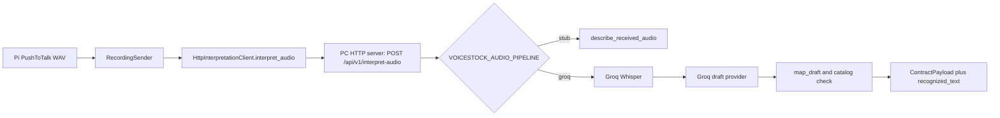

# Audio and interpretation integration

## Transcription moved to the PC (October 2026)

Running STT on the Raspberry Pi 3 proved too slow, so transcription moves to an
API called from the PC. The Raspberry Pi now sends the push-to-talk WAV
instead of recognized text:

The transport is implemented
([ADR-0007](../decisions/0007-send-push-to-talk-audio-as-raw-wav-over-http.md),
[audio interface](../interfaces/pc-audio-communication.md)).
The PC server defaults to the stub. `VOICESTOCK_AUDIO_PIPELINE` unset or
`stub` keeps `describe_received_audio` and does not return a contract.
`VOICESTOCK_AUDIO_PIPELINE=groq` runs Groq Whisper for speech-to-text, then
`openai/gpt-oss-20b` for one structured draft, then `map_draft`.
The Groq HTTP client opens with the server lifespan and closes once when the
process stops. Stub mode does not create it. Blocking transcription and
interpretation run outside the ASGI event loop.
The setup is [the PC audio pipeline guide](../setup/pc-audio-pipeline.md).
A successful `groq` response carries one version-1 contract and
`recognized_text`. A draft with zero operations or more than one is
`unsupported_command`. The Raspberry Pi validator assigns `product_id`.
An ambiguous catalog description is a service error, not a guessed product.
Confirming the operation still uses `ProvisionalOperationExecutor` and does
not persist inventory.

This is the v0.5.0 product path: physical push-to-talk capture, WAV upload,
real speech-to-text, real interpretation, contract validation, one pending
operation, confirm or cancel, and idle. It excludes inventory persistence,
a production accuracy guarantee for speech-to-text, a production accuracy
guarantee for interpretation, and more than one operation per command.
Automated tests mock Groq. They are not a live API call. The Raspberry Pi
validation campaign records one run in
[EX-TC-E2E-002-20261104-01](../testing/raspberry-validation/executions/EX-TC-E2E-002-20261104-01.md).
That run is **FAILED** on an ambiguous product command and is not
**CLOSED_PASSED**. Its v0.5.0 decision is `ACCEPTED_WITH_KNOWN_LIMITATIONS`.
The sentence above, that an ambiguous catalog description is a service error
and not a guessed product, is the intended contract. The N1 observation did
not meet it. The root cause is not identified here.
[TC-E2E-001](../testing/raspberry-validation/test-cases/TC-E2E-001.md) remains
a simulated fixture case and is not this path.

## Earlier plan: STT on the Raspberry Pi

This section is historical. It is not the v0.5.0 audio path. Speech-to-text
for that path runs on the PC through Groq Whisper, as drawn above.

The PC benchmark already executes WAV → Whisper → interpreter → experimental
JSON. It uses recorded fixtures and calls models directly. It does not exercise
GPIO, the Pi HTTP client/server path or production operation validation.

The graph is the old plan, not the current audio route. The text route's
`default_registry()` still registers only `StubProvider`. The audio route
uses `GroqDraftProvider` only when `VOICESTOCK_AUDIO_PIPELINE=groq`.
Benchmark JSON must not be treated as the official production operation
contract.

## Existing integration points

| Component | File | Entry or responsibility |
| --- | --- | --- |
| Capture path | `src/pi/audio/` | Callback stream, bounded PCM queue, and WAV publication. See [audio capture](audio-capture.md). |
| Capture completion | `src/pi/push_to_talk/controller.py` | `on_capture_completed(AudioCaptureResult)` |
| Captured audio | `src/pi/push_to_talk/result.py` | WAV path in `result.artifact.path` |
| Recording upload | `src/pi/push_to_talk/sender.py` | `RecordingSender`, a capture consumer |
| Pi transport | `src/pi/communication/client.py` | `HttpInterpretationClient.interpret(text)` and `interpret_audio(wav_path)` |
| Shared request | `src/shared/communication/contracts.py` | `InterpretationRequest(text=...)`, `WAV_MEDIA_TYPE`, `MAX_AUDIO_BYTES` and `TransportEnvelope` |
| PC HTTP | `src/pc/communication/server.py` | `POST /api/v1/interpret` and `POST /api/v1/interpret-audio`, injected handlers |
| Received audio | `src/pc/communication/audio.py` | `ReceivedAudio` and the `AudioHandler` contract |
| PC composition | `src/pc/main.py` | Connects `InterpretationService.interpret` and the audio handler to HTTP |
| PC speech-to-text | `src/pc/speech_to_text/` | `GroqWhisperTranscriber`; WAV bytes in, text or `TranscriptionError` out |
| Groq chat call | `src/pc/audio/groq_chat.py` | HTTP for the draft provider. Failures become `ProviderError` |
| Draft provider | `src/pc/interpretation/groq.py` | `GroqDraftProvider`; structured draft, no HTTP import |
| Audio pipeline | `src/pc/audio/pipeline.py` | STT, one operation, `map_draft`, catalog match, `recognized_text` |
| Pi operation cycle | `src/pi/pending_operation/flow.py` | Owns the phase and the pending operation after a capture is sent. See [the operation workflow](pending-operation-flow.md). |
| Pi process | `src/pi/runtime.py` | `voicestock-pi`: capture, client, cycle, and web UI. See [the runtime guide](../setup/pi-runtime.md). |
| Interpreter port | `src/pc/interpretation/providers.py` | `InterpretationProvider.interpret(text)`, `ProviderRegistry`, `ProviderError` |
| Service result | `src/pc/interpretation/results.py` | `ServiceResult` and typed errors |

Transport success is distinct from service success: callers must inspect both
layers. PC address and timeout use `VOICESTOCK_PC_URL` and
`VOICESTOCK_PC_TIMEOUT`; provider selection uses
`VOICESTOCK_INTERPRETATION_PROVIDER`. The text route still defaults to
`stub`. The audio route selects Groq only when `VOICESTOCK_AUDIO_PIPELINE=groq`.

## Proposed module boundaries

The following Pi-local speech-to-text boundary is the earlier offline plan.
It is not the v0.5.0 audio path. That path sends the WAV to the PC.

The STT module described for the offline plan belongs under
`src/pi/speech_to_text/` and consumes already captured WAV PCM16 mono 16 kHz.
Its public interface must hide whisper.cpp types and return text or a typed
error. It does not capture, call an API or interpret inventory commands. Use
a queued orchestration step rather than running costly inference inside GPIO
callbacks; model loading should be reusable.

The draft provider implements the existing port under `src/pc/interpretation/`
and does not import an HTTP client. The Groq request lives in
`src/pc/audio/groq_chat.py` and raises `ProviderError` without the API key or
the response body. The provider returns the internal InterpretationDraft. The
official contract mapper and the Raspberry Pi validator remain separate. The
benchmark schema does not implement them.

[SpeechToText-03](https://app.clickup.com/t/86e3euw78) and
[SpeechToText-04](https://app.clickup.com/t/86e3euwhw) own the STT interface and
adapter; [StructuredCommandInterpretation-04](https://app.clickup.com/t/86e3ev4cx)
owns the real interpreter. The PC audio path now has that provider behind
`VOICESTOCK_AUDIO_PIPELINE=groq`. A live Groq run and a physical
button-to-UI run are recorded in
[EX-TC-E2E-002-20261104-01](../testing/raspberry-validation/executions/EX-TC-E2E-002-20261104-01.md).
That record is **FAILED** on N1. It is not an acceptance of this code path
and it does not claim inventory persistence.

## Tooling and operation

The Python pipeline starts `.tools/stt/whisper-benchmark-worker`, supplies
float32 input file paths over stdin and reads one JSON result per line from
stdout. The worker source is `scripts/benchmarks/native/whisper_worker.cpp`;
its downloaded engine/build and weights are ignored by Git. Its subprocess
protocol is tooling, not an application-level interface.

Benchmark entry points are `audio_stt_llm_benchmark.py` for local Qwen,
`audio_stt_gemini_benchmark.py` for Gemini and `audio_stt_groq_benchmark.py` for
GPT OSS 20B. Shared corpus reading is in `stt_benchmark.py`; shared prompt,
experimental schema and evaluation are in `precision_benchmark.py`.

See [pipeline operation](../testing/audio-stt-llm-benchmark.md),
[engine setup](../setup/speech-to-text-models.md),
[API credentials](../setup/api-keys.md) and
[the hardware validation plan](../research/speech-to-text-engine-evaluation.md#validation-still-required).
The credential helper serves benchmark scripts. Production reads
`VOICESTOCK_GROQ_API_KEY` or `GROQ_API_KEY` and does not import that helper.

## SSH fixture integration increment

A sequential engine-independent `SpeechToText` port and `WhisperAdapter` now
exist under `src/pi/speech_to_text/`. The new SSH coordinator transfers recorded
WAVs and exercises that adapter remotely, then calls Groq from the PC. See
[the preparation and execution guide](../testing/raspberry-stt-ssh.md). Hardware
execution is pending. The earlier diagram is the original plan. The PC HTTP
server can now run the Groq audio pipeline: Groq Whisper, then
`openai/gpt-oss-20b`, then Pi contract validation, without inventory
persistence.
[EX-TC-E2E-002-20261104-01](../testing/raspberry-validation/executions/EX-TC-E2E-002-20261104-01.md)
records one physical cycle. It is **FAILED** on N1 and does not accept the
cycle as **CLOSED_PASSED**.
Connecting a recorded capture to this server and accepting it under test
criteria remains pending.
