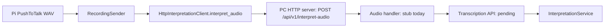
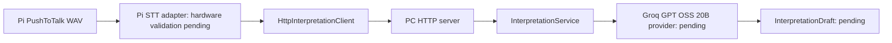

# Audio and interpretation integration

## Transcription moved to the PC (October 2026)

Running STT on the Raspberry Pi 3 proved too slow, so transcription moves to an
API called from the PC. The Raspberry Pi now sends the push-to-talk WAV
instead of recognized text:

The transport is implemented
([ADR-0007](../decisions/0007-send-push-to-talk-audio-as-raw-wav-over-http.md),
[audio interface](../interfaces/pc-audio-communication.md)). The audio handler
is still the stub `describe_received_audio` in `src/pc/main.py`. Replacing it
with transcription through the API plus `InterpretationService.interpret` is
the pending step. The sections below describe the earlier plan with STT on the
Raspberry Pi and the SSH benchmark tooling. They are kept as a record.

## Earlier plan: STT on the Raspberry Pi

The PC benchmark already executes WAV → Whisper → interpreter → experimental
JSON. It uses recorded fixtures and calls models directly. It does not exercise
GPIO, the Pi HTTP client/server path or production operation validation.

The graph is the planned application flow. Currently the PC registry only
registers `StubProvider`. Benchmark JSON must not be treated as the official
production operation contract.

## Existing integration points

| Component | File | Entry or responsibility |
| --- | --- | --- |
| Capture completion | `src/pi/push_to_talk/controller.py` | `on_capture_completed(AudioCaptureResult)` |
| Captured audio | `src/pi/push_to_talk/result.py` | WAV path in `result.artifact.path` |
| Recording upload | `src/pi/push_to_talk/sender.py` | `RecordingSender`, a capture consumer |
| Pi transport | `src/pi/communication/client.py` | `HttpInterpretationClient.interpret(text)` and `interpret_audio(wav_path)` |
| Shared request | `src/shared/communication/contracts.py` | `InterpretationRequest(text=...)`, `WAV_MEDIA_TYPE`, `MAX_AUDIO_BYTES` and `TransportEnvelope` |
| PC HTTP | `src/pc/communication/server.py` | `POST /api/v1/interpret` and `POST /api/v1/interpret-audio`, injected handlers |
| Received audio | `src/pc/communication/audio.py` | `ReceivedAudio` and the `AudioHandler` contract |
| PC composition | `src/pc/main.py` | Connects `InterpretationService.interpret` and the audio handler to HTTP |
| Interpreter port | `src/pc/interpretation/providers.py` | `InterpretationProvider.interpret(text)`, `ProviderRegistry`, `ProviderError` |
| Service result | `src/pc/interpretation/results.py` | `ServiceResult` and typed errors |

Transport success is distinct from service success: callers must inspect both
layers. PC address and timeout use `VOICESTOCK_PC_URL` and
`VOICESTOCK_PC_TIMEOUT`; provider selection uses
`VOICESTOCK_INTERPRETATION_PROVIDER`. Registering a real provider is still pending.

## Proposed module boundaries

The STT module belongs under `src/pi/speech_to_text/` and consumes already
captured WAV PCM16 mono 16 kHz. Its public interface must hide whisper.cpp types
and return text or a typed error. It does not capture, call an API or interpret
inventory commands. Use a queued orchestration step rather than running costly
inference inside GPIO callbacks; model loading should be reusable.

The principal LLM provider belongs under `src/pc/interpretation/`, implements
the existing provider port and encapsulates credentials, endpoint and failures.
It produces the internal InterpretationDraft described by the interpretation
workstream. The official contract mapper and downstream validation remain
separate responsibilities; the benchmark schema does not implement them.

[SpeechToText-03](https://app.clickup.com/t/86e3euw78) and
[SpeechToText-04](https://app.clickup.com/t/86e3euwhw) own the STT interface and
adapter; [StructuredCommandInterpretation-04](https://app.clickup.com/t/86e3ev4cx)
owns the real interpreter. The initial evaluation PR contributes exploration and documentation. The SSH
follow-up below introduces the STT port/adapter; production LLM and physical
application orchestration remain pending.

## Tooling and operation

The Python pipeline starts `.tools/stt/whisper-benchmark-worker`, supplies
float32 input file paths over stdin and reads one JSON result per line from
stdout. The worker source is `scripts/benchmarks/native/whisper_worker.cpp`;
its downloaded engine/build and weights are ignored by Git. Its subprocess
protocol is tooling, not an application-level interface.

Benchmark entry points are `audio_stt_llm_benchmark.py` for local Qwen,
`audio_stt_gemini_benchmark.py` for Gemini and `audio_stt_groq_benchmark.py` for
GPT OSS 20B. Shared corpus reading is in `stt_benchmark.py`; shared prompt,
experimental schema and evaluation are in `precision_benchmark.py`.

See [pipeline operation](../testing/audio-stt-llm-benchmark.md),
[engine setup](../setup/speech-to-text-models.md),
[API credentials](../setup/api-keys.md) and
[the hardware validation plan](../research/speech-to-text-engine-evaluation.md#validation-still-required).
The credential helper currently serves benchmark scripts; production configuration
must be introduced with the real provider rather than importing benchmark code
into `src/`.

## SSH fixture integration increment

A sequential engine-independent `SpeechToText` port and `WhisperAdapter` now
exist under `src/pi/speech_to_text/`. The new SSH coordinator transfers recorded
WAVs and exercises that adapter remotely, then calls Groq from the PC. See
[the preparation and execution guide](../testing/raspberry-stt-ssh.md). Hardware
execution is pending. The earlier diagram describes the planned HTTP application
flow: connecting physical capture and a production LLM provider remains pending.
