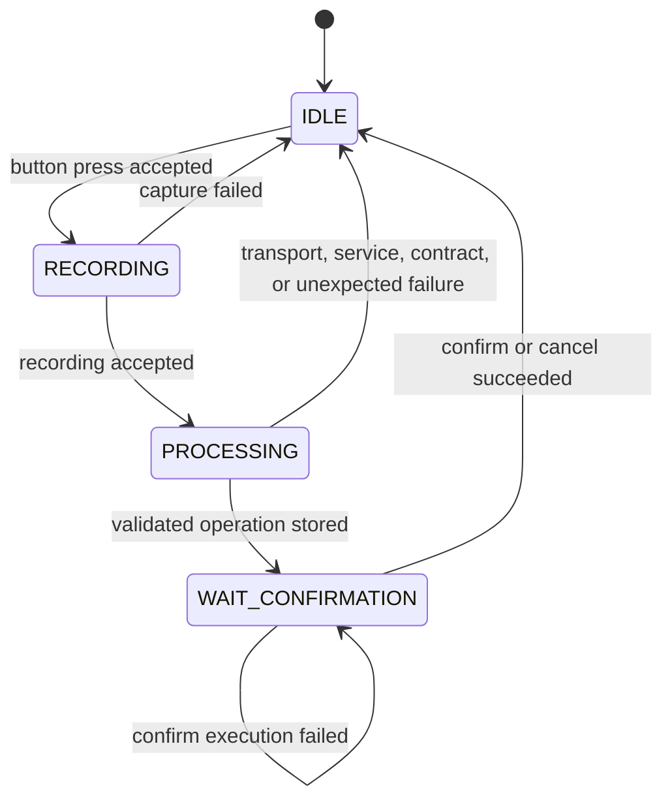

# Raspberry Pi operation workflow

`PendingOperationFlow` (`pi.pending_operation.flow`) is the orchestrator of one
spoken inventory command on the Raspberry Pi. It owns the cycle phase and the
only in-memory pending operation. Capture, HTTP, speech recognition, language
interpretation, contract rules, and inventory persistence stay in their own
components. The flow only orders those components and keeps the phase
consistent with the pending operation.

The decision to keep that ownership in one in-process object is
[ADR-0008](../decisions/0008-use-a-single-raspberry-pi-operation-workflow.md).
How to start the process is the
[integrated runtime](../setup/pi-runtime.md). The browser contract is the
[pending-operation web API](../interfaces/pending-operation-web-api.md). What
the page draws from that contract is the
[pending operation page](../interfaces/pending-operation-web-ui.md).

## Responsibility

The flow does:

- keep the operation-cycle state machine;
- accept or refuse a new capture;
- classify the PC answer and call contract validation;
- create at most one pending operation after a successful validation;
- publish the phase the operator UI may show;
- return to idle after a successful confirmation or cancellation, so another
  command can start.

The flow does not capture audio, transcribe speech, speak HTTP, call a
language model, apply product-matching rules, or write SQLite. Those belong
to `AudioCapture` and `PushToTalkController`, the PC, `OperationValidator`,
and a future inventory executor.

## State machine

The public phases are `OperationPhase`:

| Phase | Value | Meaning |
| --- | --- | --- |
| `IDLE` | `idle` | No cycle is open. A button press may start one. |
| `RECORDING` | `recording` | The microphone is held for this cycle. |
| `PROCESSING` | `processing` | The recording was accepted and the PC request is in flight. |
| `WAIT_CONFIRMATION` | `wait_confirmation` | One validated operation is waiting for the operator. |



Entering and leaving:

| Phase | Enters when | Leaves when | Allowed | Blocked |
| --- | --- | --- | --- | --- |
| `IDLE` | Process start, a failed attempt, or a successful confirm or cancel | `try_begin_recording()` accepts a press | Start a capture. Read status. | There is no pending operation to confirm or cancel. |
| `RECORDING` | `try_begin_recording()` from `IDLE` | Capture error, or a finished recording that the flow accepts | Finish or fail the capture already started | Another capture. Confirm and cancel have nothing pending. |
| `PROCESSING` | A recording is accepted while the phase is `RECORDING` | The PC answer is classified | Read status | A new capture. The pending slot is still empty, so confirm and cancel do not resolve an operation. |
| `WAIT_CONFIRMATION` | A `PendingOperation` is stored | The gateway clears that operation | Confirm or cancel that `operation_id`. Read status | A new capture. A second pending operation. |

A press that the flow refuses does not change the phase. The push-to-talk
worker asks `try_begin_recording()` before it starts the microphone, and a
`False` answer drops that press.

### Invariants

- A new cycle starts only from `IDLE`, and only when no pending operation is
  held.
- At most one pending operation exists.
- `WAIT_CONFIRMATION` is the only phase that holds one.
- `IDLE`, `RECORDING`, and `PROCESSING` hold none.
- A successful confirm or cancel removes that operation and returns to `IDLE`.
- A failed confirmation leaves the same operation pending. Cancel does not
  call the executor.

If validation finishes after `close()`, the flow drops the result and returns
to `IDLE` without storing an operation. If the phase is no longer
`PROCESSING`, or a pending operation is already present, the flow logs and
refuses to replace it.

### Push-to-talk is a different machine

`PushToTalkController` has its own states: `IDLE`, `RECORDING`, and
`WAITING_FOR_RELEASE`. They describe one button hold and the microphone.
They are not `OperationPhase`.

The controller reaches `WAITING_FOR_RELEASE` when a recording hits
`max_duration` and must wait for the physical release before another hold.
The operation flow has no such phase. While the flow is `PROCESSING` or
`WAIT_CONFIRMATION`, the controller can already be idle, and a new press is
still refused by `try_begin_recording()`.

The standalone `voicestock-pi-ptt` command does not pass
`can_start_capture`, so its controller keeps the earlier behavior and does
not enter this cycle.

## Information flow

```text
PushToTalkController
        |
        v
AudioCaptureResult
        |
        v
RecordingSender
        |
        v
HttpInterpretationClient
        |
        v
PC HTTP server
        |
        v
TransportEnvelope
        |
        v
PcResponseInterpreter
        |
        v
OperationValidator
        |
        v
ValidatedOperation
        |
        v
PendingOperationFlow
        |
        v
PendingOperation
        |
        v
WAIT_CONFIRMATION
```

Implemented on the Raspberry Pi today:

- The button notifies `PushToTalkController`. The controller records a WAV
  through `AudioCapture` and delivers an `AudioCaptureResult`.
- `RecordingSender` uploads that WAV with `HttpInterpretationClient` and
  returns a `TransportEnvelope`. The audio transport is
  [ADR-0007](../decisions/0007-send-push-to-talk-audio-as-raw-wav-over-http.md).
- `PcResponseInterpreter` separates a transport failure, a service failure,
  and a contract payload. Only a successful service payload is passed to
  `OperationValidator`.
- `recognized_text`, when the PC included it as a string, is removed before
  validation. It is not a field of `ContractPayload`. The JSON contract is
  the [operation contract](../interfaces/operation-contract.md).
- A `ValidatedOperation` becomes one `PendingOperation`. The phase becomes
  `WAIT_CONFIRMATION`.

Not implemented as a production voice pipeline:

- Speech-to-text runs conceptually on the PC, not on the Raspberry Pi. The
  PC process still wires the provisional handler `describe_received_audio`
  in `pc.main`. That handler describes the received WAV. It does not
  transcribe it and it does not return a `ContractPayload`.
- A current PC therefore answers with a payload the Pi rejects as a contract.
  The cycle returns to `IDLE` with the contract-rejection message. Replacing
  that handler is other work. This document does not treat a full spoken
  command, from microphone to confirmed stock, as validated.

The earlier plan that put speech-to-text on the Pi is recorded in
[audio and interpretation integration](audio-interpretation-integration.md).

## Pending operation

`PendingOperation` is the object the flow stores. `ValidatedOperation` is only
the inventory request the validator already accepted.

| Field | Meaning |
| --- | --- |
| `operation_id` | Identifier generated on the Raspberry Pi (`uuid.uuid4()` unless a test supplies another factory). The PC does not assign it. |
| `recognized_text` | Text the PC attached, after `strip()`. Missing, blank, or non-string input is stored as `""`. The flow does not invent a sentence. |
| `validated_operation` | The `ValidatedOperation` from `OperationValidator`. |

A pending operation is created only after validation succeeds. It lives in
the flow's memory. Creating it does not change stock, write history, or
survive a process restart.

`to_view()` builds the `PendingOperationView` the web already renders:

- `add_stock` is shown as `agregar`, `remove_stock` as `quitar`;
- the contract unit `unit` is shown as `unidad`, and the confirmation
  sentence uses `unidades` when the quantity is not 1;
- `confirmation_message` is that sentence plus the catalog product name,
  for example `Agregar 2 unidades de Coca Cola Zero 2L`.

The view is a snapshot. It is not a second stored operation. The contract
JSON itself stays defined only in the
[operation contract](../interfaces/operation-contract.md).

## Confirmation and cancellation

| Piece | Role |
| --- | --- |
| `PendingOperationFlow` | Owns the phase and the domain object. Implements `PendingOperationSlot`: `current()` and `clear(operation_id)`. |
| `PendingOperationSlot` | The seam the gateway uses. Not a second model. |
| `PendingOperationGateway` | The only object that clears the slot. Applies confirm, cancel, stale ids, and the in-memory retry record. |
| `PendingOperationQueryPort` | `get_current()`. The flow exposes the gateway as `query_port`. |
| `PendingOperationResolutionPort` | `confirm(operation_id)` and `cancel(operation_id)`. The flow exposes the same gateway as `resolution_port`. |
| `OperationExecutor` | Applies the inventory effect of one confirmation. It must not clear the slot or call the gateway. |
| `ProvisionalOperationExecutor` | The executor the runtime uses when none is injected. `execute` returns success and changes nothing. |

The flow does not reimplement the gateway rules. Confirm runs the executor
and clears the slot only after success. Cancel clears without calling the
executor. A repeated confirm of an id already confirmed in this process
returns `already_resolved` and does not execute again. The opposite action
on that remembered id returns `conflict`. An id that is not the current one
returns `stale_operation`. The HTTP mapping of those statuses is the
[web API](../interfaces/pending-operation-web-api.md).

`clear` returns the phase to `IDLE` only when the id still matches and the
phase is `WAIT_CONFIRMATION`. A failed confirm never calls `clear`, so the
operation stays pending.

The gateway remembers only the previous resolution, in this process. That
stops one lost HTTP response from executing twice. It is not durable
idempotency. A restart forgets it.

Real stock updates belong to a later executor that implements
`OperationExecutor`. No web or HTTP change is required for that swap. Until
then, a successful confirm does not modify inventory.

## Concurrency

Three mechanisms coordinate the cycle:

- **Push-to-talk worker.** Thread `voicestock-push-to-talk` serializes press,
  release, and max-duration events. `try_begin_recording()` runs on that
  worker, before `AudioCapture.start()`, so the phase change and the start
  of capture are not interleaved with another button event. GPIO callbacks
  only enqueue.
- **Processing pool.** `ThreadPoolExecutor` with one worker,
  `voicestock-operation-cycle`, runs `RecordingSender` and the interpreter.
  The button thread is not blocked on the PC timeout. A second recording is
  not processed in parallel.
- **Locks.** The flow guards phase, the pending operation, the operator
  message, and the in-flight job count with one `threading.Condition`. The
  gateway guards confirm and cancel, including the executor call, with its
  own `threading.Lock`. The gateway calls the slot while holding that lock.

Guarantees that follow from this:

- One cycle at a time. A press during `RECORDING`, `PROCESSING`, or
  `WAIT_CONFIRMATION` does not start another capture.
- At most one pending operation, published to the page as a view.
- Confirm and cancel of the same id are serialized.
- Status reads can proceed while a PC request runs. They do not change the
  phase.

Limits:

- State and the last resolution die with the process.
- There is no durable idempotency and no recovery after a restart.
- The flow does not retry a failed capture or a failed PC request.
- An unexpected exception from `AudioCapture.start()` is logged and reported
  as an `AudioStreamError`, so the worker stays alive and the flow can return
  to `IDLE`. That is a release of the current attempt, not a retry.
- If a future executor changes stock and `clear` then fails, the gateway
  reports `stale_operation` and does not remember a success. The provisional
  executor makes that retry harmless. A real executor has to define that
  boundary itself. This workflow does not.

## Errors

Operator text is Spanish, fixed in the flow. It is shown when the cycle is
back in `IDLE`. It is cleared when a new recording starts or a pending
operation is stored.

| Situation | Phase after | Pending operation | Operator message |
| --- | --- | --- | --- |
| `AudioCaptureError`, or any other exception, while starting the capture | `IDLE` | none | `No se pudo grabar el audio. Presioná el botón para intentar de nuevo.` |
| `TransportEnvelope` with status `error` | `IDLE` | none | `No se pudo comunicar con la PC. Presioná el botón para intentar de nuevo.` |
| Service result that is not a success | `IDLE` | none | `La PC no pudo interpretar el pedido. Presioná el botón para intentar de nuevo.` |
| `ValidationRejection`, including a PC payload that is not a contract | `IDLE` | none | `El pedido no es una operación válida. Presioná el botón para intentar de nuevo.` |
| Unexpected failure while sending, reading the response, or building the pending operation | `IDLE` | none | `Ocurrió un error inesperado. Presioná el botón para intentar de nuevo.` |
| Confirm and the executor returns failure, or raises | `WAIT_CONFIRMATION` | kept | none from the flow; the page explains the failure |
| Confirm success, or cancel success | `IDLE` | removed | cleared |

A capture error is applied only while the phase is `RECORDING`. The same
callback in another phase does not move the cycle.

Advanced recovery, automatic retries, and persistence of a failed attempt are
out of scope.

## Limits

- The pending operation is not persisted.
- Inventory is not modified.
- No operation history is written.
- Confirmation uses `ProvisionalOperationExecutor` unless a caller injects
  another `OperationExecutor`.
- The PC voice pipeline still depends on replacing `describe_received_audio`.
- `recognized_text` is optional. The current contract does not require it.
  The page hides that section when the string is empty.
- A physical run of the whole path, from the button to a real PC contract
  and back to the page, is a separate validation. This document describes
  the implemented orchestration, not that demonstration.

## Public status and the web

`get_status()` returns an `OperationCycleStatus`: phase, headline, detail,
optional `operator_message`, and the pending view only in
`WAIT_CONFIRMATION`. The integrated runtime passes the flow itself as the
status port of `create_app`.

`GET /api/v1/system-status` copies that snapshot. The route does not change
the phase. Field names, status codes, and the confirm and cancel routes are
specified once in the
[pending-operation web API](../interfaces/pending-operation-web-api.md).

The page polls that endpoint. It does not press the button, start a capture,
or choose the next phase. Confirm and cancel go through the resolution port
and name the `operation_id` on screen.
